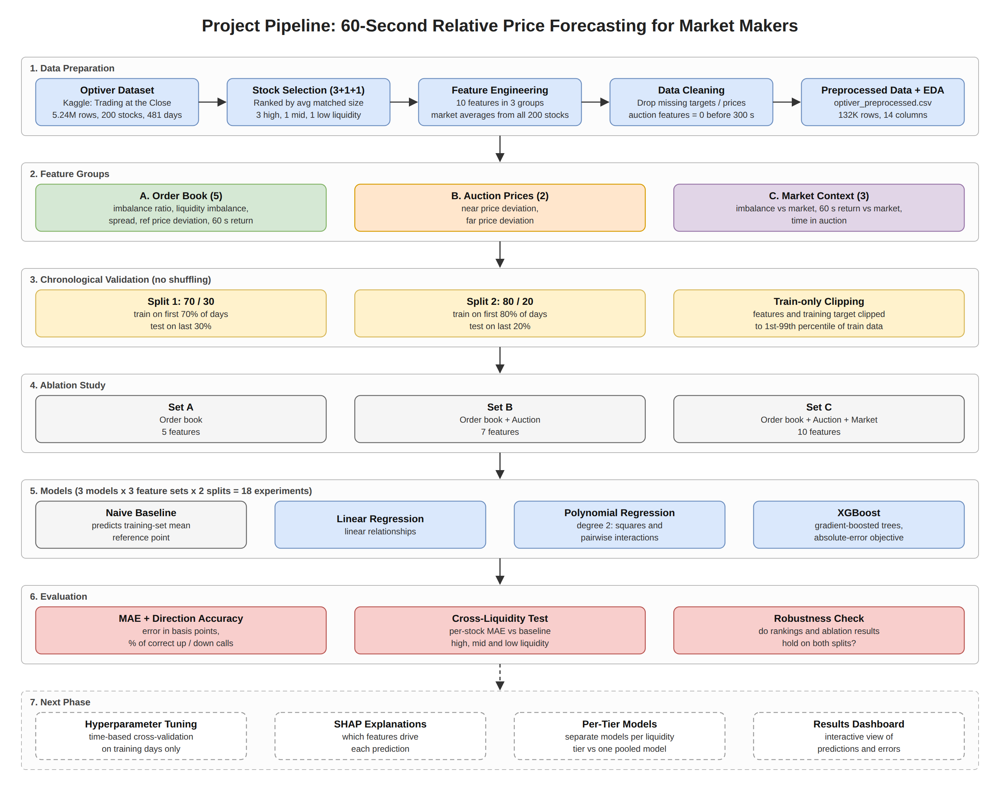
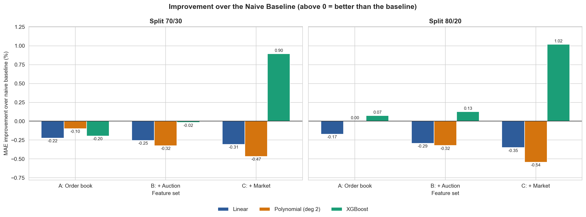
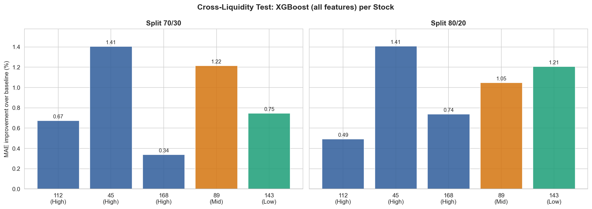

# 60-Second Relative Price Forecasting for Market Makers

A proof of concept for CSET211 Statistical Machine Learning at Bennett University. The project predicts how much a NASDAQ stock will move **relative to the market** over the next 60 seconds of the closing auction, using Optiver's "Trading at the Close" data from Kaggle.



## Problem

Every trading day NASDAQ ends with a closing auction that runs from 15:50 to 16:00. Market makers keep quoting prices during it, so knowing which stocks are likely to beat or trail the market over the next minute helps them quote tighter, safer prices.

The target, in basis points (1 bp = 0.01%):

```
target = (stock WAP(t+60) / stock WAP(t) - index WAP(t+60) / index WAP(t)) x 10,000
```

For example, if the stock rises 12 bps and the index rises 5 bps, the target is +7 bps.

## Data

- Source: Kaggle competition [Optiver - Trading at the Close](https://www.kaggle.com/competitions/optiver-trading-at-the-close/data), file `train.csv`: 5,237,980 rows, 17 columns, 200 stocks, 481 trading days, one snapshot every 10 seconds.
- The raw file is not part of this repository. Download it and place it at `data/train.csv` (see [data/README.md](data/README.md)).
- Five stocks are kept by liquidity (3 most liquid, the median and the least liquid), which gives 132,275 rows:

| Stock | Liquidity tier | Average matched size (USD) |
|---|---|---|
| 112 | High | 893,969,959 |
| 45 | High | 799,247,595 |
| 168 | High | 485,907,607 |
| 89 | Mid | 17,024,329 |
| 143 | Low | 653,206 |

## Features

| Group | Features | What they capture |
|---|---|---|
| A. Order book | `imbalance_ratio`, `liquidity_imbalance`, `spread`, `ref_price_dev`, `return_60s` | Buying or selling pressure, trading cost and the stock's recent move |
| B. Auction prices | `near_price_dev`, `far_price_dev` (0 before 300 s, when they are not yet published) | Where the auction would clear right now |
| C. Market context | `rel_imbalance`, `rel_return_60s`, `seconds_in_bucket` | The stock compared with all stocks at the same second, and time into the auction |

Prices are in basis points and sizes are ratios, so stocks of very different size share one scale. Formulas are in the notebook (section 6).

## Method

- **Chronological splits** by trading day, no shuffling: 70/30 (train days 0-335, test 336-480) and 80/20 (train 0-383, test 384-480).
- **No leakage:** clipping limits (1st and 99th percentile) come from the training days only; the test target is never changed; `return_60s` only looks back; market averages use the same second only.
- **Models:** naive baseline (training mean), Linear Regression, Polynomial Regression (degree 2), XGBoost (300 trees, depth 4, learning rate 0.05, absolute-error loss).
- **Ablation:** feature sets A, A + B and A + B + C. 3 models x 3 feature sets x 2 splits = 18 experiments.
- **Metrics:** MAE in basis points and direction accuracy (share of correct up/down calls).

## Results (Milestone 2)

Test set, all ten features:

| Model | MAE 70/30 | MAE 80/20 | vs baseline (70/30 / 80/20) | Direction 70/30 | Direction 80/20 |
|---|---|---|---|---|---|
| Naive baseline | 5.0037 | 4.7798 | - | 48.5% | 48.3% |
| Linear Regression | 5.0191 | 4.7966 | 0.31% / 0.35% worse | 51.6% | 51.4% |
| Polynomial (degree 2) | 5.0271 | 4.8058 | 0.47% / 0.54% worse | 52.3% | 52.1% |
| **XGBoost** | **4.9589** | **4.7310** | **0.90% / 1.02% better** | **54.0%** | **53.7%** |



Per stock, XGBoost has lower error than the baseline on all five stocks on both splits, by 0.34% to 1.41%:



Main findings:

- Only XGBoost beats the baseline. With all features both regression models are slightly worse, so the useful signal is most likely non-linear.
- Market context is the most useful feature group: for XGBoost it lowers MAE by 0.046 and 0.043 bps, which fits a target that is defined relative to the market.
- The edge is small, as expected at a 60-second horizon where price moves are mostly noise (no feature has a correlation above 0.05 with the target).

All 20 result rows are in `results/experiments.csv` and the per-stock test in `results/per_stock.csv`. Every graph in the [notebook](notebooks/milestone2_analysis.ipynb) has a short explanation of what it shows and what we learn from it.

## Repository structure

```
closing-auction-forecast/
├── data/                  train.csv goes here (not committed); the preprocessed CSV is written here
├── docs/                  pipeline diagram
├── figures/               graphs saved by the notebook
├── notebooks/
│   └── milestone2_analysis.ipynb   dataset, EDA, 18 experiments and explanations
├── results/               experiments.csv, per_stock.csv
├── src/
│   ├── config.py          paths, feature groups, split sizes, XGBoost settings
│   ├── data.py            loading, stock selection, features, cleaning
│   └── models.py          splits, models, experiments, per-stock test
├── run_pipeline.py        runs the whole pipeline without Jupyter
└── requirements.txt
```

## How to run

Python 3.10 or newer.

```bash
python -m venv .venv
.venv\Scripts\activate          # Windows; on macOS/Linux: source .venv/bin/activate
pip install -r requirements.txt
```

1. Put `train.csv` in the `data/` folder.
2. Open `notebooks/milestone2_analysis.ipynb` and run all cells. It writes `data/optiver_preprocessed.csv`, the graphs in `figures/` and the tables in `results/`.
3. Or, for the numbers only: `python run_pipeline.py`

The random seed is fixed (`random_state=42`), so a rerun with the same library versions gives the same results.

## Project status

| Milestone | Content | Status |
|---|---|---|
| 1 | Problem, existing solutions, objectives, dataset | Done |
| 2 | Data collection, preprocessing, EDA, model selection and justification | Done |
| 3 | Tuning with time-based cross-validation, SHAP explanations, per-tier models, dashboard prototype, final report | Planned |

## Author

Arshpreet Singh (S25CSEU0980), B.Tech Computer Science Engineering, Bennett University.

Data: Optiver, "Optiver - Trading at the Close", Kaggle competition, 2023.
